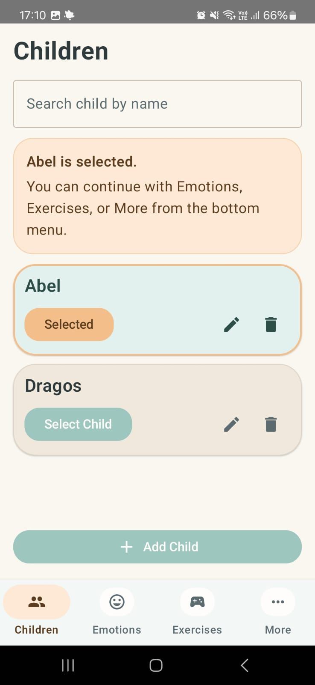
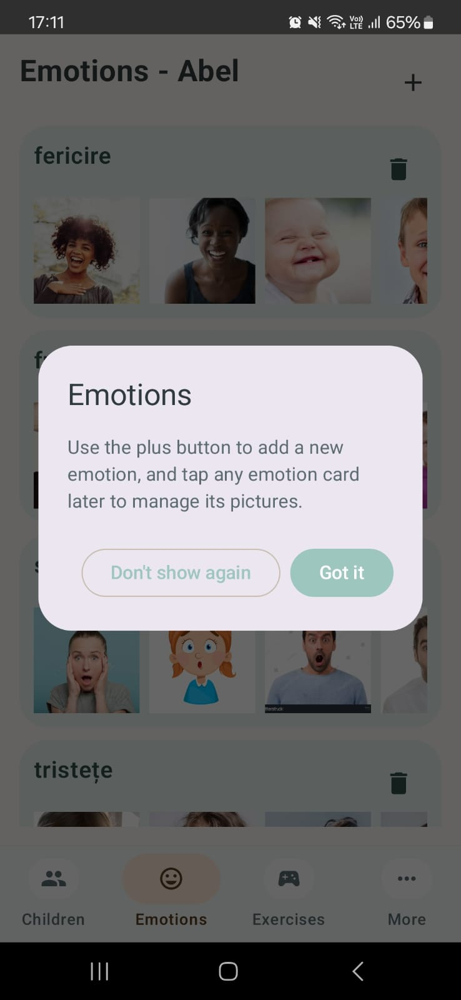
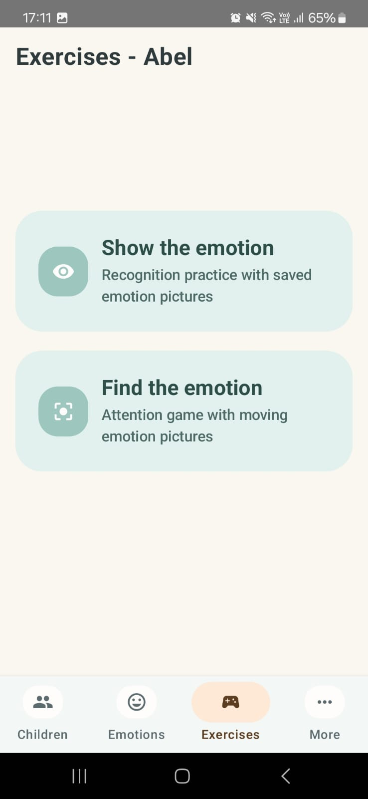
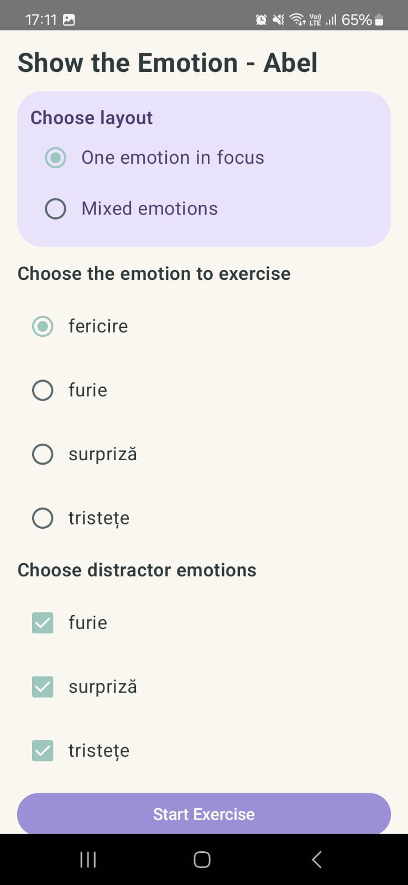
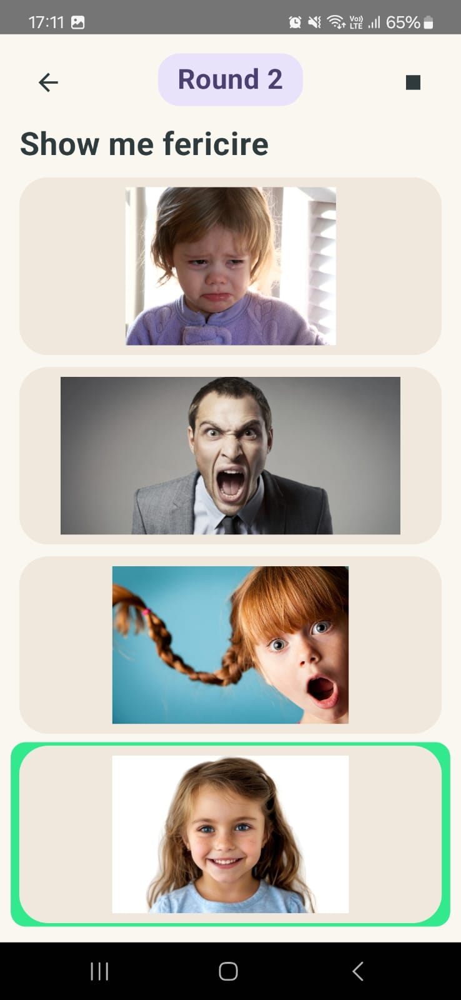
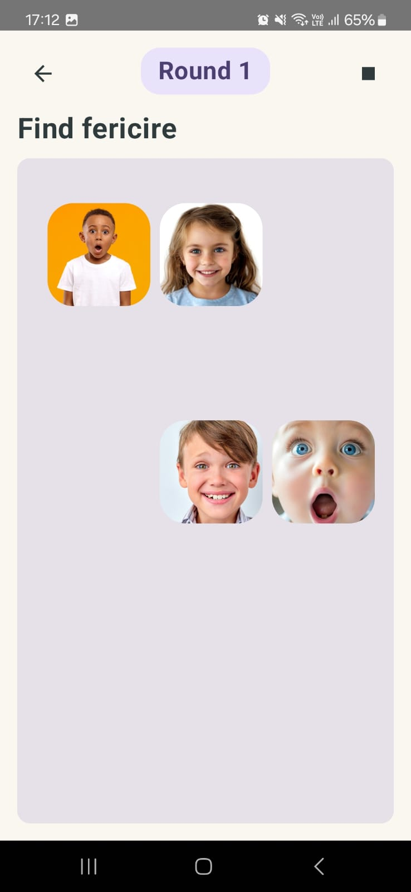
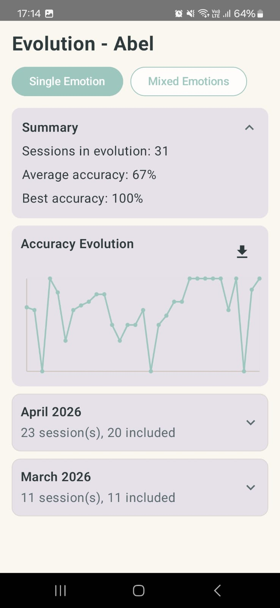
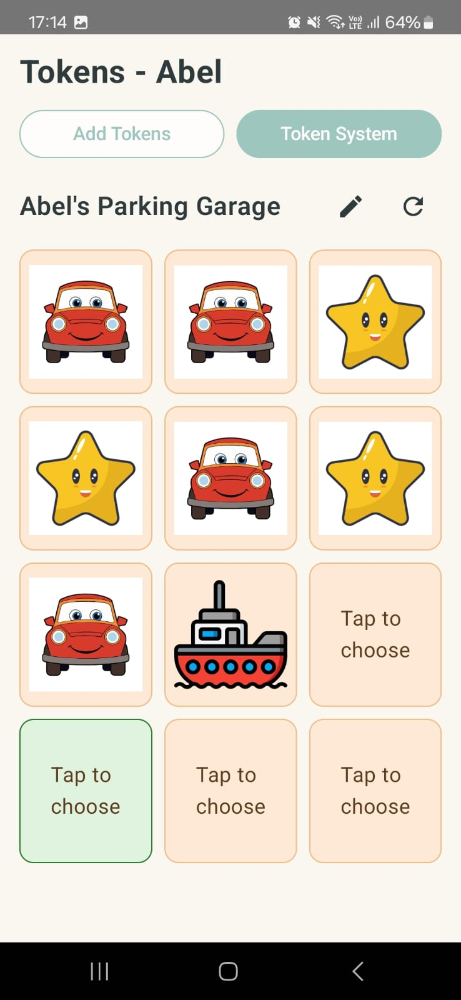
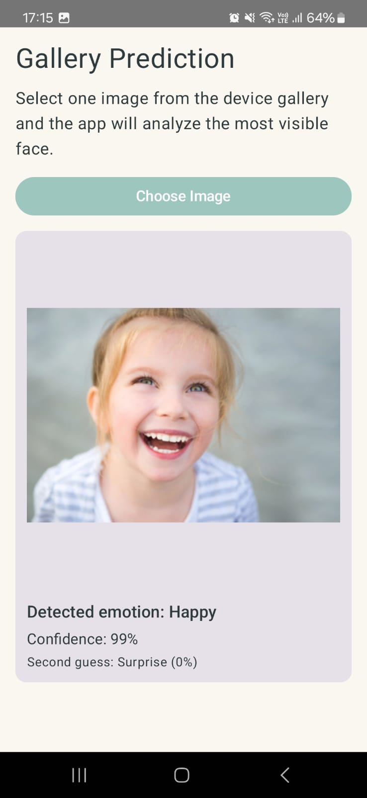

# EmotiSteps

EmotiSteps is an Android application designed to support emotion learning activities for children with Autism Spectrum Disorder. The app combines personalized visual materials, interactive exercises, progress tracking, a visual token reward system, and an on-device facial emotion recognition module.

## Screenshots

  
  
  

  
  
  

  
  
  

## Features

- Child profile management with separate progress tracking.
- Custom emotion and image management.
- Interactive emotion recognition exercises.
- Visual token reward system for motivation.
- Session history, statistics, and progress charts.
- Gallery-based and live facial emotion recognition.
- Local data persistence with Room and SQLite.
- On-device inference using ML Kit and TensorFlow Lite.

## Tech Stack

- Kotlin
- Jetpack Compose
- Material 3
- MVVM-inspired architecture
- Room / SQLite
- CameraX
- ML Kit Face Detection
- TensorFlow Lite / LiteRT
- Gradle

## Architecture

The app follows an MVVM-inspired architecture adapted with a central state store. UI screens are built with Jetpack Compose and react to shared application state exposed through ViewModels. Data is stored locally using Room, while the AI Recognition module combines CameraX, ML Kit Face Detection, image preprocessing, and a TensorFlow Lite model for on-device inference.

## AI Recognition

The facial emotion recognition module uses ML Kit for face detection and a pre-trained TensorFlow/Keras CNN model converted to TensorFlow Lite for Android inference. The model classifies facial expressions into six categories: angry, fear, happy, neutral, sad, and surprise.

The model was not trained from scratch in this project. The main contribution is the mobile integration pipeline: face detection, image preprocessing, TensorFlow Lite inference, live camera analysis, and prediction smoothing.

Model source: [tharinda-pamindu/Facial_Emotion_Detection_model_ft](https://huggingface.co/tharinda-pamindu/Facial_Emotion_Detection_model_ft)

## Highlights

- Built a complete Android app using Kotlin and Jetpack Compose.
- Designed local persistence with Room and reactive data flows.
- Implemented reusable state management across multiple app modules.
- Integrated CameraX and ML Kit for real-time face detection.
- Converted and integrated a TensorFlow/Keras model into TensorFlow Lite.
- Designed the app around clarity, personalization, and therapeutic use cases.

## Setup

1. Clone the repository.
2. Open the project in Android Studio.
3. Sync Gradle dependencies.
4. Run the app on an emulator or Android device.

## Requirements

- Android Studio
- Android SDK 24+
- Camera permission for live AI Recognition

## Disclaimer

This application is an educational prototype and is not intended for medical diagnosis or clinical decision-making.
